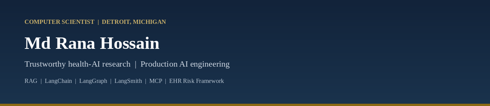

  

  <a href="https://ranasl62.github.io/ranasl62/"><strong>Personal page</strong></a>
  &nbsp;·&nbsp;
  <a href="https://scholar.google.com/citations?user=GV-UbncAAAAJ">Google Scholar</a>
  &nbsp;·&nbsp;
  <a href="https://orcid.org/0009-0005-5996-719X">ORCID</a>
  &nbsp;·&nbsp;
  <a href="https://www.linkedin.com/in/mdranahossain/">LinkedIn</a>
  &nbsp;·&nbsp;
  <a href="https://github.com/ranasl62">GitHub</a>
  &nbsp;·&nbsp;
  <a href="mailto:mdrana.hossain@miu.edu">Email</a>

  
  
  
  
  
  

---

## About

Explainable AI for early medical diagnosis: peer-reviewed deep learning on medical images and clinical data (knee osteoporosis, first author; colorectal cancer; diabetic retinopathy; Alzheimer’s; gastrointestinal endoscopy; brain imaging). **Leakage-aware, calibrated EHR risk** modeling, including the open EHR Risk Framework, is a supporting methods thread—alongside industrial delivery of **RAG**, **agentic workflows**, **MCP** tool-use, chat assistants, and task automation on U.S. platforms.

Healthcare outputs are **research and education methodology**, not a medical device and not bedside deployment. Volkswagen employment is production engineering; independent scholarship (publications, book, EHR Risk Framework) is not owned by that employer.

**M.S. Computer Science** (GPA 3.93) · Senior Full Stack Engineer, Volkswagen Group of America · Detroit, MI

---

## Production AI &amp; platforms

Grounded retrieval, agent orchestration, tool protocols, tracing, and full-stack delivery—not clinical chatbots.

<table>
<tr>
<td width="50%" valign="top">

**Retrieval-augmented generation (RAG)**  
Ingestion, chunking, embeddings, hybrid retrieval, reranking · cited answers on technical documents · Solr + vector search (FAISS, Qdrant, Pinecone, Chroma, Weaviate) · Amazon Bedrock / Hugging Face

</td>
<td width="50%" valign="top">

**Agentic AI &amp; LangGraph**  
LangChain / **LangGraph** (plan → tool → verify) · tool use, memory, guardrails · Infomedia and feedback-analysis agents · CrewAI-style coordination for bounded tasks

</td>
</tr>
<tr>
<td width="50%" valign="top">

**MCP, tools &amp; LangSmith**  
**Model Context Protocol (MCP)** for structured tool/API access · **LangSmith** tracing, run evaluation, prompt/dataset iteration · IBM/Coursera: vector DBs, RAG apps, agents with MCP

</td>
<td width="50%" valign="top">

**Chat, automation &amp; ops**  
Grounded chat over internal knowledge · task automation to cut manual handoffs · OpenTelemetry, ELK, Prometheus/Grafana patterns · Docker, GitHub Actions, Jenkins, SonarQube

</td>
</tr>
</table>

**Application engineering:** Java 21 / Spring Boot · Angular (4→18, NgRx) · TypeScript · Python · FastAPI · React · Ionic/Capacitor · MySQL / PostgreSQL / MongoDB · Kafka · GraphQL · AWS · Kubernetes / Terraform (prior roles)

---

## Research

Explainable, validated AI for early diagnosis from medical images and clinical data. Supporting methods work uses index-time feature contracts, patient-level splits, calibration, and SHAP, and is shipped as inspectable software.

**EHR Risk Framework** — creator &amp; maintainer. Index/horizon cohorts, leakage audits, isotonic calibration (Brier, ECE), TreeSHAP, fairness slices, JSON manifests, FastAPI + Angular UI. MIT License · synthetic verification only.

[GitHub](https://github.com/ranasl62/ehr-risk-framework) · [Zenodo](https://doi.org/10.5281/zenodo.21448693) · [Docs](https://ehr.larucare.com/) · [Demo](https://ehr-risk-framework.larucare.com/)

**Book** — lead author. *Artificial Intelligence in Healthcare: Early Disease Detection and Clinical Risk Prediction from Electronic Health Records.* First Edition, 2026. ISBN **978-984-29284-1-3**.

---

## Peer-reviewed publications

Roles match publisher author lists. Full formatting on the [personal page](https://ranasl62.github.io/ranasl62/).

| Role | Work | Venue |
|------|------|--------|
| First author | Hybrid DL for knee osteoporosis (CNN + multimodal LLM) | IEEE ICSADL 2026 · [doi](https://doi.org/10.1109/ICSADL67539.2026.11451868) |
| Co-author | CRuSE-Heart: risk-controlled selective ensembles | Springer *Discover AI* 2026 · [doi](https://doi.org/10.1007/s44163-026-01378-x) |
| Co-author | Feature-weighted calibrated tabular explainable AI for heart disease prediction | Springer *Discover AI* 6, 1642 (2026), published 25 October 2026 · [doi](https://doi.org/10.1007/s44163-026-02360-3) |
| Co-author | Colorectal cancer image classification | IEEE ICSADL 2026 · [doi](https://doi.org/10.1109/ICSADL67539.2026.11452002) |
| Co-author | Diabetic retinopathy ensemble classification | IEEE ICARC 2026 · [doi](https://doi.org/10.1109/ICARC68737.2026.11453518) |
| Co-author | Alzheimer’s stage classification (transfer learning) | IEEE AISEI 2026 · [doi](https://doi.org/10.1109/AISEI68628.2026.11572889) |
| Co-author | Hybrid ViT–CNN for GI endoscopy | IEEE AISEI 2026 · [doi](https://doi.org/10.1109/AISEI68628.2026.11572866) |
| Co-author | Life-jacket detection (YOLOv8) | EAI *AI and Robotics* 2025 · [doi](https://doi.org/10.4108/airo.9785) |
| Co-author | AI/ML in drug discovery (systematic review) | IEEE ICSSAS 2025 · [doi](https://doi.org/10.1109/ICSSAS66150.2025.11081368) |
| Co-author | Jute-leaf disease CNNs + interpretability | IEEE ICSADL 2026 · [doi](https://doi.org/10.1109/ICSADL67539.2026.11451802) |
| Co-author | License-plate YOLO + OCR (XAI) | RTIP2R 2025 |
| Co-author | Fabric defect detection (XAI) | RTIP2R 2025 |
| Co-author | Alzheimer’s multimodal brain imaging | ICEFronT 2026 · *accepted* |
| Lead author | EHR early detection &amp; clinical risk (book) | ISBN 978-984-29284-1-3 |

*Under review (not yet published):* brain-tumor XGBoost (Elsevier ESWA); CNN/GNN brain-tumor MRI (Elsevier *Healthcare Analytics*).

---

## Peer review service

**12 completed** reviews. The three *Biomedical Physics &amp; Engineering Express* reviews are Web of Science (Clarivate) verified.

- *Biomedical Physics &amp; Engineering Express* (IOP) — 3 · WoS verified  
- *PLOS ONE* — 1 · manuscript PONE-D-26-29250  
- *International Journal of Public Health Practice and Promotion* — 1  
- HIS 2026 · aiHealth 2026 · ICISSC 2026 — 1 each  
- AMIA 2027 Amplify Informatics Conference — 4  

Training: Nature Masterclasses *Focus on Peer Review*; Elsevier Researcher Academy (2026).

---

## Professional experience

**Senior Full Stack Engineer** — Volkswagen Group of America, Auburn Hills, MI · Apr 2024 – present · Hybrid  
Production LangChain/LangGraph **RAG** with cited answers · **agentic** workflows (Infomedia, feedback) · **MCP** · **LangSmith** tracing · grounded **chat** · task automation · Spring Boot + Angular 18 (led 4→18, NgRx) · ELSA2Go/AWS · Connected Car, myVW+, SiriusXM, CARFAX · Docker, GitHub Actions, Jenkins, SonarQube

**Software Engineer &amp; Director** — The Tech Nerds Limited · Oct 2021 – Jan 2023  
Monolith → microservices (Spring Boot, NestJS, React) · JWT / Spring Security · Kafka, GraphQL, Kubernetes, Terraform, AWS

**Software Specialist / Associate** — SSL Wireless (FinTech) · May 2018 – Sep 2021  
High-traffic recharge microservices · QR payments, Kafka, ELK, eKYC · Employee of the Month, Dec 2020

---

## Education &amp; credentials

| | |
|--|--|
| **M.S. Computer Science** | Maharishi International University · 2023–2025 · GPA 3.93/4.00 |
| **B.S. CSE** | Southeast University, Dhaka · 2015–2019 · GPA 3.97/4.00 |
| **Certifications** | AWS Solutions Architect – Associate · Johns Hopkins health informatics · IBM/Coursera RAG &amp; MCP agents · Hugging Face AI Agents Fundamentals |
| **Memberships** | IEEE Professional Member · AMIA · ACAIM · HIMSS Digital |
| **Awards** | SSL Employee of the Month (2020) · ACM ICPC Dhaka (2018) · NCPC MBSTU (2017) |

---

  <a href="https://ranasl62.github.io/ranasl62/">ranasl62.github.io/ranasl62</a>
  &nbsp;·&nbsp;
  mdrana.hossain@miu.edu

Research software is not a clinical product or FDA-cleared device.

